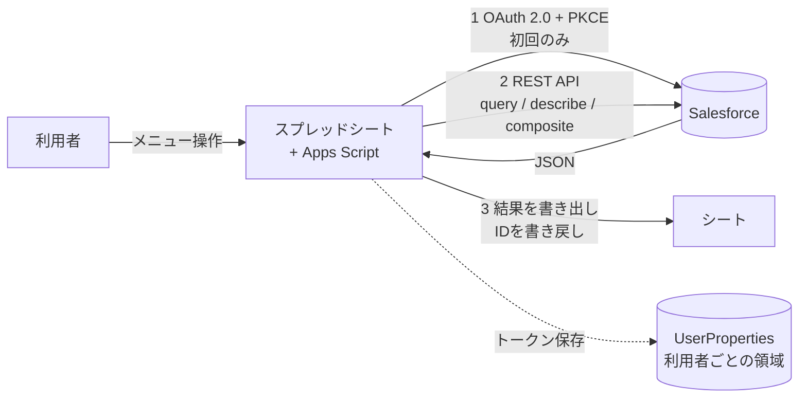
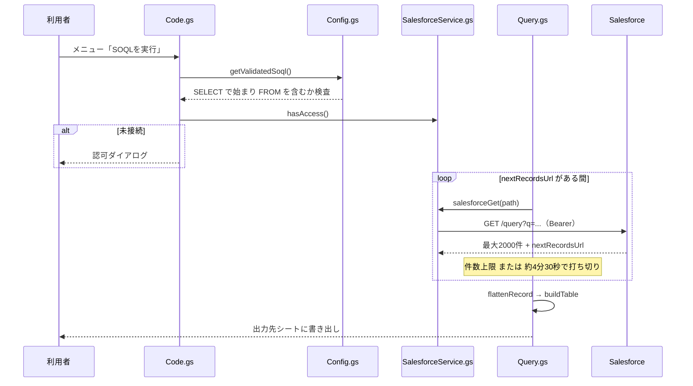
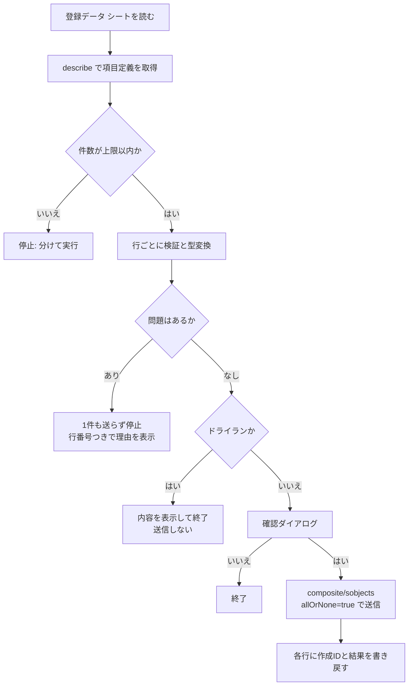
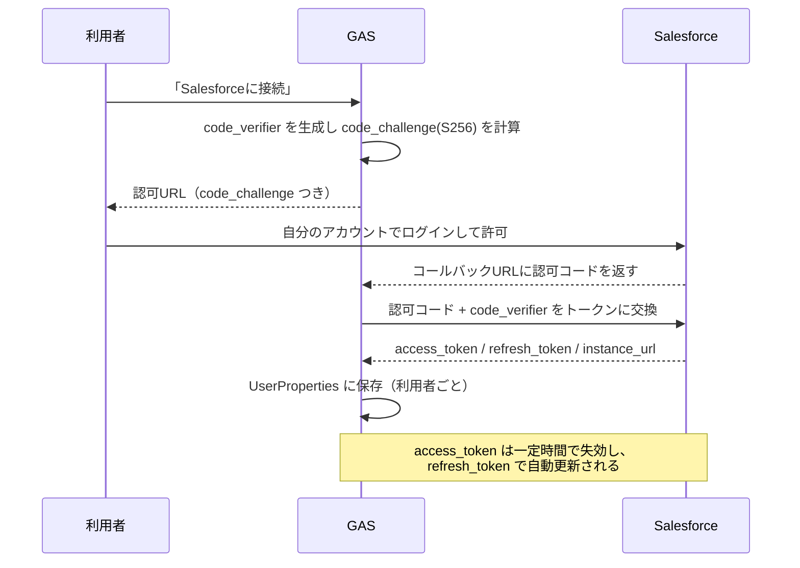

# 仕組み（GAS版）

GAS版がどう動いているかの説明。保守・改修する人向け。
構築と運用は [OPERATIONS.md](OPERATIONS.md)、セキュリティは [SECURITY.md](SECURITY.md) を参照。

## 全体像

スプレッドシートに紐づいた Apps Script（コンテナバインド）として動く。
利用者はメニューを選ぶだけで、Salesforce の REST API を**自分自身の権限で**呼び出す。



## ファイルの役割と依存関係

| ファイル | 役割 | 呼び出す先 |
|---|---|---|
| `Code.gs` | メニュー定義と操作の入口。ダイアログ表示 | `Config` `SalesforceService` `Query` `Import` |
| `Config.gs` | 設定シートの読み書き・正規化・検証 | （他に依存しない） |
| `SalesforceService.gs` | OAuth認証とREST呼び出し（GET/POST）、エラーの日本語化 | `Config` `OAuth2` |
| `Query.gs` | SOQL実行（ページング）、入れ子項目の平坦化、シート出力 | `SalesforceService` `Config` |
| `Import.gs` | シートの検証・型変換・一括作成・結果の書き戻し | `SalesforceService` `Config` |
| `OAuth2.gs` | OAuth2ライブラリ本体（同梱・未改変・Apache-2.0） | — |

依存は一方向。`Config` が最下層で、`Code` が最上層。

## 処理の流れ

### SOQLの実行（読み取り）



### 一括登録（書き込み）



## 認証の仕組み（OAuth 2.0 認可コードフロー + PKCE）



- **PKCE**：認可コードが途中で盗まれても、`code_verifier` を知らなければトークンに交換できない。
  シークレットを持てない構成（スプレッドシートに秘密を置きたくない）でも安全に使うための仕組み
- コールバックURLは `https://script.google.com/macros/d/{スクリプトID}/usercallback`。
  **スクリプトIDが変わるとURLも変わる**（運用上の注意は OPERATIONS.md）
- 更新トークンのローテーションが有効な場合、更新のたびに新しい refresh_token が発行される。
  ライブラリが保存し直す。複数の実行が同時に更新しようとしても、ライブラリのロックで直列化される

### 更新に失敗したときの挙動（重要）

ライブラリの `hasAccess()` は、トークン更新に失敗しても**例外を投げず `false` を返す**。
理由は内部に保持されるだけで、放っておくと「未接続」としか見えない。
このため `SalesforceService.gs` の `authFailureReason_()` で理由を取り出し、
接続ダイアログとエラーに表示している。

## 設計上の判断

| 判断 | 理由 |
|---|---|
| 設定を**項目名で引く**（行の位置で読まない） | 設定項目を増減しても読み違えないため。以前、行の位置で読んでいて新旧のシートで食い違った |
| 設定シートに**不足行を自動補完** | 機能追加で設定項目が増えても、古いシートで新機能が使えなくならないため |
| 設定シートの値列を**書式なしテキスト**に | スプレッドシートが `60.0` を数値 `60` にしてしまい、URLが `/v60/` になって 404 になったため |
| APIバージョンを**正規化** | 上記の救済。`60` `v60.0` `60.0` のどれでも受ける |
| 一括登録は **`allOrNone: true`** | 1件でも失敗したら全件取り消し。中途半端な登録が残らない |
| **送信前に全件検証**し、1件でも問題があれば1件も送らない | 取り消せない操作なので、手元で止められるものは止める |
| **ドライラン**と確認ダイアログ | 同上。内容を見てから実行できる |
| **作成IDを各行に書き戻す** | 誤登録に気づいたとき、消すための手がかりになる |
| 約**4分30秒**で打ち切る | GASの実行上限は6分。超えて強制終了されると取得済みの結果も失われる |
| 結果の書き出しを**2000行ずつ**に分割 | 大量件数で `setValues` が重くならないように |
| `OAuth2.gs` を**同梱** | ライブラリIDで検索してもヒットしない事象があったため。貼るだけで使える |
| `attributes` を除外・リレーションを**ドット表記**に平坦化 | Salesforce は入れ子で返すため、そのままでは表にならない |
| サブクエリ（子リレーション）は `[n件]` と表示 | 表に展開できないため |

## 制限値

| 項目 | 値 | 由来 |
|---|---|---|
| GASの1回の実行時間 | 約6分 | Google の仕様。コードは約4分30秒で打ち切る |
| `composite/sobjects` の1回の件数 | 200件 | Salesforce の仕様 |
| 一括登録の上限（設定） | 既定200件・最大200件 | 上記に合わせ、誤送信の歯止めにも |
| 最大取得件数（設定） | 既定5000件 | 安全のための上限 |
| Salesforce の1回の応答 | 最大2000件 | 続きは `nextRecordsUrl` で取得 |

GAS の呼び出し回数・Salesforce の API 利用回数にも、日次などの上限がある
（契約やアカウント種別によって異なる）。大量に実行する運用では確認すること。

## 改修するとき

1. `gas/` 配下を編集する
2. **テストを実行する**（Googleアカウントも Salesforce も不要）

   ```bash
   node gas/test/test_gas.js      # 検索・出力・認証まわり
   node gas/test/test_import.js   # 一括登録・設定
   ```

3. 変更したファイルを Apps Script のエディタに**貼り替える**
   （現状は手動。コードの正は GitHub のリポジトリ）
4. スプレッドシートを開き直して動作確認

> **コードを書き換えるときの落とし穴**
> `.gs` は `.js` ではないため、そのままでは `node --check` が通らない。
> 構文を確認するなら `.js` にコピーして実行する。
> テストは偽のサービス（`SpreadsheetApp` `UrlFetchApp` `OAuth2`）を差し込む作りで、
> 新しい GAS の API を使い始めたら、偽物にもそのメソッドを足す必要がある。
